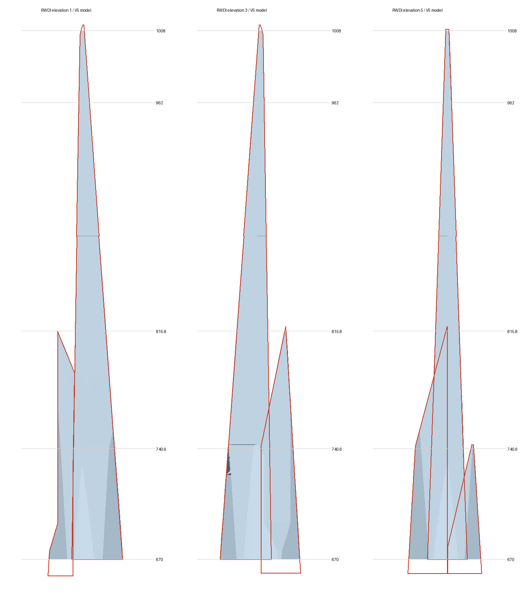

# Jeddah Tower — Blender V5 修订稿

可编辑的吉达塔模型、参数及生成脚本。**当前部分完成，总高1008m为用户指定值，不是对公开设计版本高度的重新认定。**

[完整 Blender 模型](jeddah_tower_1008m_v5.blend) · [修改及缺项](docs/STATUS.md) · [参考资料](docs/SOURCES.md) · [建模约束 prompt](docs/REBUILD_PROMPT_ZH.md)



## 当前状态

- 塔冠由RWDI原始三向矢量立面轮廓约束，并限制在来源Y形截面的竖向投影以内；删除旧独立楔体和728m平顶封口。隐藏凹面的形状仍不能由三向轮廓唯一确定。
- 幕墙使用约1.5m横向单元分格，曲面几何细分不再直接充当幕墙分格。
- 观景台的台面、连桥、下托体为一个闭合连接体；内部钢构收进包板。
- **当前没有阳台。** 旧分组位置已被否定并撤下，尚未取得逐层定位和平面轮廓；旧参数仅作为被否定记录归档。
- L158来源为463m²部分楼板，原整层板已撤下，缺少轮廓的部分未猜补。
- 裙房及观景台部分尺寸仍由图像拟合，不能视作施工复原；2011体型与2013楼层资料存在版本差异。

[网格检查](reports/mesh_checks.json)已通过：塔冠和观景台各为一个闭合体，塔冠最高点1008m。网格检查通过不表示建筑形态已经全部核准。

## 文件

| 路径 | 内容 |
| --- | --- |
| `jeddah_tower_1008m_v5.blend` | 当前完整场景，可直接打开 |
| `assets/` | 分部件 Blender 资产；阳台集合目前为空 |
| `src/` | 截面、主体、塔冠、观景台、裙房生成代码 |
| `parameters/` | 参数、资料核定项及被否定的旧阳台分组 |
| `renders/` | 当前模型预览与塔冠对照图 |
| `reports/` | 网格检查、楼板轮廓和来源配准记录 |

## 重建与检查

本次生成环境：macOS、Blender5.2.0 Alpha、Cycles/Metal。生成脚本目前选择Metal GPU，其他平台需调整设备设置。无需第三方Python包。

在仓库根目录执行：

```sh
blender -b --python-exit-code 1 --python build_reconstruction.py
blender -b jeddah_tower_1008m_v5.blend --python-exit-code 1 --python check_model.py
blender -b jeddah_tower_1008m_v5.blend --python-exit-code 1 --python render_checks.py -- hero crown crown_150 terrace_top terrace_side podium
```

`parameters/rejected_balcony_groups_v4.json`不是可复用的定位表。`reports/crown_source_register.json`记录矢量坐标及配准方法。参考原件保留出处与摘要信息，本仓库不打包第三方PDF或宣传图片。
